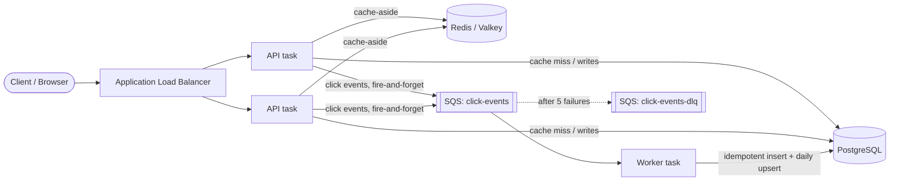

# Distributed URL Shortener with Click Analytics

A production-style URL shortener built with **Java 25 and Spring Boot**: fast redirects through a Redis cache, asynchronous click analytics through SQS, full observability with Prometheus and Grafana, load testing with k6, and deployment to **AWS ECS Fargate with Terraform**.

The focus of this project is the engineering around a simple product: unique short-code generation across instances, caching and cache-failure handling, idempotent event processing, and measuring real capacity under load.

---

## Architecture



**One codebase, two roles.** The same Docker image runs as the **API** (serves create and redirect requests) and as the **worker** (consumes click events), selected by a config flag. Each scales independently, and a slow worker can never slow down redirects.

### Request flows

**Create** `POST /api/v1/urls`
```
validate input → custom alias? save it (409 if taken)
               → otherwise generate a code and save it (retry on rare collision)
               → evict the code from the cache → 201 Created
```

**Redirect** `GET /{code}` (the hot path)
```
Redis hit             → 302 (no database)
Redis "missing" mark  → 404 (no database)
Redis miss            → single-flight: one DB query per code per instance
                          not found → cache "missing" for 60s → 404
                          expired   → 410 Gone
                          found     → cache with expiry-aware TTL → 302
then publish a click event to SQS (never blocks or fails the redirect)
```

**Analytics** (background)
```
SQS batch (≤10) → one transaction:
                    insert raw events (ON CONFLICT DO NOTHING on event_id)
                    upsert per-link daily counts for newly inserted events only
               → success: messages deleted · failure: redelivered · 5 failures: DLQ
```

---

## Tech stack

| Area | Tools |
|---|---|
| Language & framework | Java 25, Spring Boot 4, Spring Data JPA, Bean Validation, Lombok |
| Data | PostgreSQL 17 (Flyway migrations, declarative partitioning), Redis / Valkey |
| Messaging | Amazon SQS with a dead-letter queue (Spring Cloud AWS); ElasticMQ locally |
| Resilience | Resilience4j circuit breaker, request coalescing (single-flight) |
| Observability | Micrometer, Prometheus, Grafana, CloudWatch |
| Testing | JUnit 5, Mockito, AssertJ, MockMvc, Testcontainers, Awaitility, k6 |
| Infrastructure | Docker, Terraform (S3 remote state with locking), AWS ECS Fargate (ARM64/Graviton), ALB, RDS, ElastiCache, SQS, ECR, Secrets Manager, IAM |
| CI | GitHub Actions on every PR, branch protection on `main` |

---

## Key design decisions

### 1. Short-code generation: unique, non-sequential, no retries

Codes are 7 Base62 characters (62⁷ ≈ 3.5 trillion combinations, sized from a capacity estimate of ~1.8 billion links over 5 years).

```
Postgres sequence (blocks of 1,000) → multiplicative permutation → Base62 → "kQ8zP2a"
```

- **Hi/lo block allocation:** each instance reserves 1,000 IDs per database call (`INCREMENT BY 1000`) and hands them out from memory under a lock. One DB round trip per 1,000 links, and no collisions across instances.
- **Permutation:** `(id × M) mod 62⁷` with `M` coprime to 62⁷ is a bijection, so codes stay unique but no longer reveal creation order to casual enumeration. (It's obfuscation, not cryptographic secrecy; a keyed Feistel cipher would be the hardened version.)
- **Custom aliases** share the same primary-key column. The database constraint is the guard, not a check-then-insert, so there's no race. The entity implements `Persistable` so a duplicate alias causes an `INSERT` failure (→ `409`) rather than a silent `UPDATE` that would hijack someone else's link.

### 2. Caching: cache-aside with three protections

- **Expiry-aware TTL:** `min(24h, time until the link expires)`. A cached entry always disappears before its link expires, so "in the cache" means "valid."
- **Negative caching:** unknown codes are cached as a marker for 60 seconds, so floods of random codes don't reach Postgres (cache penetration). Creating a link evicts its key.
- **Single-flight:** concurrent misses for the same hot key share one database query per instance, using a `ConcurrentHashMap` of `CompletableFuture`s with atomic `putIfAbsent`. This prevents cache stampedes without a distributed lock, and keeps working when Redis is down.

### 3. Redis is optional for availability

The database is the source of truth; the cache must never become a single point of failure.
- 100 ms command timeouts instead of the client's 60-second default
- A circuit breaker opens after repeated failures and routes reads straight to Postgres, then probes Redis again after 10 seconds
- Redis is excluded from the health check, so a cache outage can't make the load balancer remove healthy instances

Verified with outage drills: with Redis stopped, redirects keep returning `302` while the dashboard shows the breaker open, the hit ratio drop, and DB connections rise, then recover automatically.

### 4. Click analytics: at-least-once delivery, exactly-once counts

- Redirects publish events **fire-and-forget**. Analytics is allowed to be slightly lossy; redirects are not allowed to be slow. Publish failures are counted as a metric.
- Each event carries a **UUID created at the source**. The worker inserts with `ON CONFLICT DO NOTHING` and only counts rows that were actually inserted, so SQS redeliveries never double-count.
- Raw events and daily aggregates are written in **one transaction**; SQS messages are deleted only after commit.
- `click_events` is **partitioned by month**, so retention means dropping a partition instead of deleting billions of rows. The API reads only the small `daily_clicks` table.

### 5. Analytics API: keyset (cursor) pagination

`GET /api/v1/urls/{code}/analytics?from=&to=&granularity=day|week|month&limit=&cursor=`

- Buckets via `date_trunc`, read from the `(code, day)` primary-key index
- Opaque, URL-safe Base64 cursors ("periods after X") instead of offsets, so pages stay fast at any depth and stable as data changes
- Fetches `limit + 1` rows to detect a next page without a separate count query

### 6. Errors

All errors use **RFC 9457 Problem Details** via a single `@RestControllerAdvice`: `400` validation, `404` not found, `409` alias taken, `410` expired, and a generic `500` that never leaks internal messages.

---

## API

| Method | Path | Success | Notes |
|---|---|---|---|
| `POST` | `/api/v1/urls` | `201` + `Location` | Body: `longUrl` (required, http/https), `alias` (optional, 3–32 chars `[A-Za-z0-9_-]`), `expiresAt` (optional, ISO-8601, must be in the future) |
| `GET` | `/{code}` | `302` + `Location` | `404` unknown, `410` expired |
| `GET` | `/api/v1/urls/{code}/analytics` | `200` | `from`, `to` (ISO dates, default last 30 days), `granularity`, `limit` (≤100), `cursor` |

```bash
curl -i -X POST http://localhost:8080/api/v1/urls \
  -H "Content-Type: application/json" \
  -d '{"longUrl":"https://example.com/some/long/path","alias":"my-link"}'

curl -i http://localhost:8080/my-link

curl -s "http://localhost:8080/api/v1/urls/my-link/analytics?granularity=day"
```

---

## Running locally

**Prerequisites:** Java 25, Docker.

```bash
docker compose up -d        # Postgres, Redis, ElasticMQ (SQS), Prometheus, Grafana
./mvnw spring-boot:run      # uses the "local" profile by default
```

| Service | URL |
|---|---|
| App | http://localhost:8080 |
| Grafana (admin / admin) | http://localhost:3000/d/url-shortener |
| Prometheus | http://localhost:9090 |
| ElasticMQ UI | http://localhost:9325 |

Configuration is split by Spring profile: `application.yaml` (shared), `application-local.yaml` (local endpoints), and `application-aws.yaml` (TLS for Redis, metrics not exposed). On AWS, addresses and secrets arrive as environment variables, and AWS credentials come from the ECS task role.

---

## Testing

```bash
./mvnw test
```

70+ tests across the testing pyramid:
- **Unit:** Base62, the permutation (including a no-collision check over 100k IDs), expiry rules, service logic with Mockito, single-flight concurrency, circuit-breaker fallback
- **Web slice:** controllers with MockMvc: statuses, headers, validation, Problem Details
- **Integration:** Testcontainers for Postgres, Redis, and an SQS-compatible ElasticMQ: sequence block allocation under 10,000 concurrent virtual threads, duplicate-alias rejection, and the end-to-end SQS → worker → Postgres pipeline with duplicate delivery

CI runs the full suite on every pull request; merges to `main` require it to pass.

---

## Observability

A provisioned Grafana dashboard shows the four golden signals plus app-specific metrics:

- **Traffic:** requests/sec by status
- **Errors:** 5xx rate
- **Latency:** redirect p50 and p99 (from Micrometer histograms)
- **Saturation:** Hikari DB connections in use
- **Cache hit ratio**, **click events published vs. failed**, **Redis circuit-breaker state**

On AWS, infrastructure metrics (ALB latency and request count, ECS CPU, RDS, ElastiCache, SQS backlog) come from CloudWatch.

---

## Load testing (k6)

The test uses an **open model** (constant arrival rate), so a slow server can't hide its slowness by throttling the load generator. A warm-up phase is excluded from the SLO thresholds: **p99 < 50 ms**, **< 1% errors**, and **no dropped requests**.

```bash
k6 run -e BASE_URL=http://localhost:8080 -e RATE=500 load/redirect-test.js
```

### Results

| Environment | Rate | Result |
|---|---|---|
| Laptop (app, k6, and all containers on one machine) | ~1,000 req/s | 0 errors, median 1.2 ms; tail latency degraded once the machine reached 100% CPU (the app itself used under half) and the Redis breaker briefly tripped, then recovered |
| Laptop | 500 req/s | Steady-state p99 in the low milliseconds, 100% cache hit ratio, ≤ 3 of 10 DB connections in use |
| AWS, 2 × 0.5 vCPU Fargate tasks, k6 on an in-region EC2 instance | 200 and 500 req/s | **Over capacity.** Median stayed ~3–4 ms, but requests queued faster than they were served: p99 reached 10–15 s, 7–8% errors |

**What the AWS run showed:** with one vCPU in total, the API saturated at roughly **100–150 redirects/sec**. Past that point, latency didn't degrade gradually; the queue grew without bound. Slow health-check responses then caused ECS to **replace a task mid-test**, leaving one task with all the traffic: a cascading failure.

**Fixes for production:** more CPU per task (1+ vCPU; the JVM also falls back to the Serial GC under 2 CPUs), CPU-based autoscaling before saturation, load shedding (fail fast with `503` instead of queuing), and health checks tuned so a busy task isn't mistaken for a dead one.

---

## Deploying to AWS

Everything is defined in [`infra/`](infra) with Terraform: a VPC across two availability zones, security groups chained ALB → app → data stores, RDS PostgreSQL and ElastiCache Valkey in private subnets with encryption at rest and in transit, SQS with a DLQ, ECR, ECS Fargate (ARM64) services for the API and the worker with deployment circuit breakers, and least-privilege IAM roles. The database password is generated by RDS and injected from Secrets Manager; no credentials live in code or images.

```bash
# 1. Build and push the image, tagged with the commit
REPO=$(terraform -chdir=infra output -raw ecr_repository_url)
TAG=$(git rev-parse --short HEAD)
aws ecr get-login-password | docker login --username AWS --password-stdin "${REPO%/*}"
docker build --platform linux/arm64 -t "$REPO:$TAG" . && docker push "$REPO:$TAG"

# 2. Deploy
terraform -chdir=infra apply -var="image_tag=$TAG"

# 3. Tear down when finished
terraform -chdir=infra destroy -var="image_tag=$TAG"
```

Terraform state is stored in a versioned S3 bucket with native lock files. The full stack costs roughly $0.25–0.30/hour while running, so it's created for testing sessions and destroyed afterwards.

**Deliberate cost trade-offs** (and their production equivalents):
- App tasks in public subnets with security groups allowing only the ALB, instead of private subnets with a NAT gateway or VPC endpoints
- Single-node RDS and Valkey, instead of Multi-AZ RDS and a Valkey replica with automatic failover
- HTTP on the ALB's address, instead of HTTPS with an ACM certificate on a custom domain

---

## Known gaps and next steps

- **Rate limiting on link creation:** designed (Redis token bucket via a Lua script, per client) but not yet built
- **Authentication and link ownership** (API keys), so analytics are visible only to the link's owner
- **Autoscaling and right-sized tasks**, then re-measure capacity on AWS
- **Continuous deployment:** GitHub Actions with OIDC (no stored AWS keys) to build, push, and roll out
- **App-level metrics on AWS** via Amazon Managed Prometheus or an OpenTelemetry collector
- **Automated partition management** (e.g. pg_partman) and retention for `click_events`
- **Keyed permutation** (Feistel network) for cryptographically unpredictable codes

---

## Project structure

```
src/main/java/com/kyo/url_shortener/
├── shortcode/     Base62, permutation, ID block allocator, code generator
├── url/           entity, repository, service, cache, create/redirect controllers
├── analytics/     click publisher, SQS listener, processor, analytics API
├── common/        SingleFlight
├── config/        clock and web configuration
└── web/           global exception handler (Problem Details)
src/main/resources/db/migration/   Flyway migrations (urls, partitioned click tables)
infra/             Terraform for AWS
load/              k6 load test
grafana/, prometheus/, elasticmq/  local observability and SQS configuration
```
